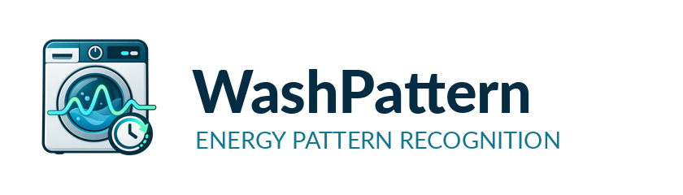

# Washing Machine Energy Pattern Recognition

A self-learning **Home Assistant custom integration** that recognizes washing programs from smart-plug power readings and estimates when the cycle will end. Runs locally, with no additional apps, Home Assistant helpers, cloud account, API key, or subscription.



## Features

- Pick any Home Assistant power sensor (W, mW, or kW) in the native setup dialog, with configurable start/end thresholds and timing.
- Automatically capture complete cycles and archive their raw readings in a separate SQLite file. Previously recorded Home Assistant Recorder history can be imported for the last 1–9 days.
- Convert irregular readings to time-weighted 30-second mean/max profiles, compute DCT coefficients, and group similar cycles using constrained DTW.
- Compare a running cycle with archived profiles using prefix-DTW and estimate the remaining time only when a sufficiently similar reference exists.
- Save partial cycles across Home Assistant restarts. No network requests or extra Python packages.
- One native Home Assistant **device with only four entities**. No helpers or automations are created.
- Fully local; independent of the smart plug vendor and manufacturer model. The plug is read-only.

## Install using a HACS custom repository

1. In **HACS → ⋮ → Custom repositories**, enter:
   `https://github.com/niki11euro/ha_washing-machine-energy_pattern-recognition`
2. Choose **Integration** as the category, then add it.
3. Find **Washing Machine Energy Pattern Recognition** in HACS, select **Download**, and select **`main`** if HACS asks which branch/version to install.
4. Restart Home Assistant so that the new manifest and branding are loaded.
5. Open **Settings → Devices & services → Add integration → Washing Machine Energy Pattern Recognition** and select the washer's power sensor.

**Requirement:** Home Assistant **2026.3.0 or later** (needed for bundled brand icons). Home Assistant Recorder must track the source sensor for history import. The integration also monitors live changes without needing Recorder history.

**Manual install:** Copy `custom_components/washing_machine_energy_pattern_recognition/` to the identically named directory under your Home Assistant `/config/custom_components/`, restart Home Assistant, then add the integration from Devices & services.

## Home Assistant entities

Only four entities are created per washer, all attached to **one device**:

| Entity | Purpose |
|---|---|
| **Running** (binary sensor) | `on` while a wash cycle is detected; attributes include current power and last completed cycle details. |
| **Detected pattern** | Manually named program or automatically clustered pattern during a run. Archive count and last-cycle identification are available as attributes while idle. |
| **Estimated remaining time** | Minutes until completion; confidence score, matched cycle IDs and DTW distance are available as attributes. |
| **Estimated finish** | Estimated finish timestamp, visible only when there is a plausible match. |

The interface includes German and English entity names. Missing predictions intentionally remain unavailable/unknown until a sufficiently similar historical pattern has been learned. The confidence score is a **heuristic**, not a calibrated percentage probability.

## Settings and actions

Under **Settings → Devices & services → Washing Machine Energy Pattern Recognition → Configure**, adjust start and end thresholds (defaults: 5 W / 2.5 W), start confirmation (20 s), end confirmation (8 min), minimum duration (10 min), prediction timing (first at 10 min, then every 5 min) and history import lookback.

Home Assistant **Developer tools → Actions**:

```yaml
action: washing_machine_energy_pattern_recognition.import_history
data:
  days: 7
```

```yaml
action: washing_machine_energy_pattern_recognition.label_cycle
data:
  cycle_id: 3
  label: Cotton 40°C
```

The `cycle_id` for the latest cycle is an attribute of the **Running** binary sensor and the **Detected pattern** sensor. Supply `entry_id` for these actions if more than one washer is configured. Historical imports are idempotent for approximate matching start times.

## Upgrading from 0.1.x

Version **0.2.0** fixes the integration's category: it is now an ordinary **device integration**, not a Home Assistant **helper**. Earlier releases were incorrectly marked `integration_type: helper`, which made Home Assistant show the whole integration among helpers. **No actual standalone helpers were created by the integration.**

The new version deliberately exposes **four** entities instead of eight. The entities `Status`, `Prediction confidence`, `Archived cycles`, and `Last completed cycle` are no longer provided; their useful information is now exposed as attributes of the remaining entities. Their former entity registry entries may need to be removed manually using **Settings → Devices & services → Entities**, filtering for the integration and checking existing automation/dashboard references first. **Do not delete your washer's Shelly entities or unrelated helpers.** The new version preserves the `unique_id` of the four remaining entities and leaves the historical archive intact.

To upgrade with HACS, use **Update information** followed by **Download** with `main` if the old short-commit download returns a 404, then restart Home Assistant. The incorrect `helper` classification disappears after reloading the new manifest.

## How the maths works

1. Power updates are observed when the source entity changes. Buffered live samples are persisted approximately every 30 seconds while a cycle is running.
2. When a complete cycle is detected, raw Recorder updates and live samples are merged, archived, and resampled into regular 30-second intervals.
3. DCT-II of `log(1 + watts)` produces a compact cycle descriptor; DTW compares the actual mean/max interval profile so that short peaks are not lost to DCT compression.
4. Similar profiles receive a `Pattern N` group. During a run, restricted prefix-DTW estimates the remaining duration from up to three nearest completed cycles.
5. If no historical run matches closely enough, the sensors remain unknown rather than reporting a misleadingly confident prediction.

Identifying manufacturer program names from power readings alone is unreliable. Assign known labels manually when useful; more repetitions improve the accuracy of estimates. Washing programs may include long low-power pauses: increase the end confirmation duration if a cycle is detected as complete too early.

## Data and privacy

The archive is stored at `/config/washing_pattern_<config_entry_id>.db`. It contains timestamped power samples, computed profiles, DCT coefficients, and any program labels you set. Include these files in your Home Assistant backups. No data is transmitted outside Home Assistant. Uninstalling the integration does not automatically erase the database.

The integration never turns off the smart plug and does not edit existing automations. Integrations, sensors and historical measurements from other projects remain untouched.

## Development

```bash
python -m unittest discover -s tests -v
```

The repository includes HACS, hassfest, and Python checks via GitHub Actions. MIT-licensed. Problems and pull requests are welcome under [GitHub Issues](https://github.com/niki11euro/ha_washing-machine-energy_pattern-recognition/issues).
